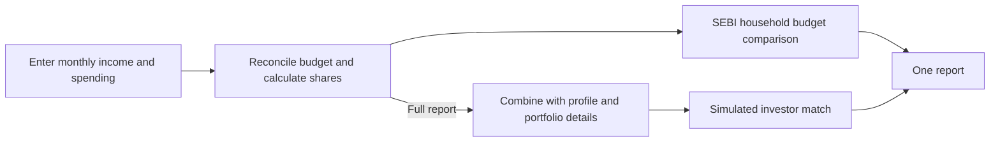

# SegmentIQ

**Explore how you invest and where your monthly income goes.**

SegmentIQ is an educational investor profiling app. It combines a simulated investor match and a comparison with household budgets from the SEBI Investor Survey 2025 in one report.

[](#technology-stack)
[](#technology-stack)
[](#technology-stack)

**[Try SegmentIQ live](https://segmentiq-khaki.vercel.app/)** · [Read the project guide](docs/project-guide.md) · [Explore the API](https://segmentiq-khaki.vercel.app/docs)


## Contents

- [The problem](#the-problem)
- [How the workflow works](#how-the-workflow-works)
- [Demo walkthrough](#demo-walkthrough)
- [What the results represent](#what-the-results-represent)
- [Implementation status](#implementation-status)
- [Technology stack](#technology-stack)
- [Run locally](#run-locally)
- [API](#api)
- [Testing and validation](#testing-and-validation)
- [Repository guide](#repository-guide)

## The problem

A person's portfolio mix, investing habits, and monthly cash flow answer different questions. SegmentIQ brings those inputs together so a visitor can explore how their full profile compares with simulated scenarios and how their budget compares with a measured survey sample. People without a current portfolio can still explore their budget.

## How the workflow works



The full report uses both paths. **No current portfolio** uses only the budget path.

## Demo walkthrough

1. Select **Use example** to explore the report, or enter your own details.
2. Allocate your monthly take-home income across regular expenses, savings, loan repayments, investments, and other expenses. The live chart updates as you enter amounts. For the investor profile, equity, fixed deposits, and debt assets must total 100%.
3. Select **Generate my report**. If you select **No current portfolio**, the form asks only for budget details and returns the budget comparison.

### Worked example

The built-in profile has a monthly take-home income of **₹1,60,000**. Each share is the category amount divided by income. The app rounds the displayed shares to a total of 100%.

| Monthly allocation | Amount | Share shown |
|---|---:|---:|
| Regular expenses | ₹85,000 | 53.13% |
| Savings | ₹32,000 | 20% |
| Loan repayments | ₹0 | 0% |
| Investments | ₹30,000 | 18.75% |
| Other expenses | ₹13,000 | 8.12% |
| **Total** | **₹1,60,000** | **100%** |

The example returns **Growth-accumulator** as the simulated investor match and **Near-zero loan repayments** as the survey budget comparison. The [report walkthrough](docs/project-guide.md#read-the-report) shows the result and explains each section.

## What the results represent

| Result | Reference data | How to read it |
|---|---|---|
| Simulated investor match | 1,600 reproducibly generated profiles | The closest of four simulated groups, with descriptive averages and common characteristics. |
| Monthly budget comparison | 17,824 eligible investor-sample interviews from the SEBI Investor Survey 2025 | The closest of three survey budget groups. Reference averages come from 1,800 held-out interviews. |

The synthetic model uses 11 numeric and five categorical features. It selected four clusters from K=2 through K=8 across five seeds, with mean silhouette **0.3061** and mean seed stability **ARI 1.0000**. The generator allocates expenses, borrowing repayments, investing, and savings as separate uses of income.

The SEBI model compares five budget shares after a square-root transform. The published survey describes these budgets at the household level. Applicability to people without a portfolio has not been established. The app provides descriptive comparisons for exploration. Investment suitability and performance require additional information. [SEBI Investor Survey 2025](https://www.sebi.gov.in/reports-and-statistics/research/jan-2026/investor-survey-2025-_99170.html)

## Implementation status

| Capability | What works today |
|---|---|
| Monthly budget | Live chart, amount left to allocate, and input validation |
| Full profile report | Simulated match, SEBI comparison, profile readout, and group statistics |
| Budget-only report | Survey comparison with the simulated profile fields skipped |
| Model build | Repeatable synthetic generator and training script. Survey inference uses bundled aggregate centers and reference averages. |
| Hosting and storage | Vercel serves the FastAPI app. Submissions are processed in memory. |
| Research validation | The synthetic evaluation describes generated profiles. Applicability of the SEBI model to people without portfolios remains open. |

## Technology stack

| Layer | Technology | Role |
|---|---|---|
| Browser | HTML, CSS, JavaScript | Input form, budget chart, and report views |
| Service | Python 3.13, FastAPI, Pydantic | Static serving, request validation, and inference |
| Modeling | scikit-learn, NumPy, pandas, joblib | Synthetic generation, K-means, summaries, and saved artifacts |
| Hosting | GitHub and Vercel | Production builds from `main` |

## Run locally

Install Python 3.13 and run these commands from the repository root on Windows.

```powershell
py -3.13 -m venv .venv
.\.venv\Scripts\python.exe -m pip install -r ml/requirements.txt
.\.venv\Scripts\python.exe -m ml.src.generate_synthetic_dataset
.\.venv\Scripts\python.exe -m ml.src.train
.\.venv\Scripts\python.exe -m uvicorn backend.main:app --reload
```

Open [the local app](http://127.0.0.1:8000/) or [the local API docs](http://127.0.0.1:8000/docs). FastAPI serves the HTML, CSS, and JavaScript directly. The app requires no frontend build, database, or API key.

## API

| Method | Path | Returns |
|---|---|---|
| GET | `/health` | Synthetic model artifact readiness |
| GET | `/segments` | Descriptive summaries of the simulated groups |
| POST | `/report` | Both results for `{profile, budget}`, or a budget result when `profile` is `null` |
| POST | `/predict` | A simulated group and its descriptive summary |
| POST | `/sebi/predict` | A survey budget comparison for `{budget}` |

The budget object contains percentage shares named `expenses`, `savings`, `loan_repayments`, `investment`, and `other`. For a combined report, shared values in the budget and profile must agree, and the investment share must cover the monthly SIP. Invalid requests return HTTP 422.

To try the combined report on the local server using the same sample as the browser:

```powershell
$profile = Get-Content ml/examples/profile.json -Raw | ConvertFrom-Json
$budget = @{ expenses = 53.125; savings = 20; loan_repayments = 0; investment = 18.75; other = 8.125 }
$body = @{ profile = $profile; budget = $budget } | ConvertTo-Json -Depth 4
Invoke-RestMethod http://127.0.0.1:8000/report -Method Post -ContentType 'application/json' -Body $body
```

## Testing and validation

- Run **Use example** and generate the full report. Select **No current portfolio** and generate it again to check the budget-only response.
- Run the API example above to exercise the same input as the browser. A combined request with contradictory budget and profile shares should return HTTP 422.
- Rebuild the synthetic dataset and model using the local setup commands. The trainer prints candidate K scores, seed agreement, and group sizes. [Model workflow](ml/README.md)
- After a deployment, check [production health](https://segmentiq-khaki.vercel.app/health) and repeat both report paths.

## Repository guide

| Path | Contents |
|---|---|
| [`frontend/`](frontend/) | Form, live budget chart, and report |
| [`backend/`](backend/) | FastAPI routes, validation, and aggregate SEBI model |
| [`ml/`](ml/) | Synthetic data generator, training, inference, and example input |
| [`docs/`](docs/) | Project guide, architecture, scope, roadmap, and historical research |
| [`pyproject.toml`](pyproject.toml) and [`vercel.json`](vercel.json) | Vercel build and runtime settings |

Vercel builds from GitHub `main` and regenerates the synthetic artifacts. Git tracks the aggregate SEBI model and workbook hash. The original workbook, input CSVs, generated datasets, and local artifacts stay outside version control.

[Architecture](docs/architecture.md) · [Scope](docs/requirements.md) · [Roadmap](docs/roadmap.md) · [Contributing](CONTRIBUTING.md)
