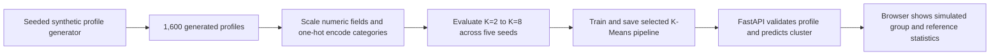

# SegmentIQ

SegmentIQ is an educational investor-profile segmentation demo. It turns a sample financial profile into a match against one of four **simulated** groups, using a reproducible synthetic dataset and an unsupervised K-Means pipeline.

> **Demo limitation:** the app currently uses generated scenario data, not verified observations from real investors. Its groups are not validated investor personas, its match is not a probability or risk assessment, and it does not provide financial advice. Submitted profiles are used for the response and are not saved.

[](https://www.python.org/)
[](https://fastapi.tiangolo.com/)
[](https://scikit-learn.org/)

## Demo

- **Live app:** [segmentiq-khaki.vercel.app](https://segmentiq-khaki.vercel.app/)
- **API health:** [/health](https://segmentiq-khaki.vercel.app/health)
- **Segment summaries:** [/segments](https://segmentiq-khaki.vercel.app/segments)
- **Interactive API docs:** [/docs](https://segmentiq-khaki.vercel.app/docs)

## What it does

- Collects age, location tier, employment, income, expenses, savings, debt, SIP contribution, asset allocation, experience, literacy, risk comfort, and financial goal.
- Checks profile bounds and consistency, including a 100% total for equity, fixed deposits, and debt assets.
- Applies the same fitted preprocessing and clustering pipeline used during model training.
- Shows the closest simulated group and its descriptive profile statistics.
- Provides `/health`, `/segments`, and `/predict` endpoints through FastAPI.
- Builds the generated data and model artifacts as part of a Vercel deployment.

## How the pipeline works



The synthetic archetype column is excluded from model features. It is used only after clustering to describe how closely a cluster lines up with the generator’s scenarios. The model compares candidate cluster counts using mean silhouette score, with seed stability as a tie-breaker. Four archetypes are built into the current generator and the deployed explorer displays four groups; this is a demonstration design, not evidence that real investor data has four natural clusters.

The supplied `Indian_Personal_Finance_Behavior_Dataset_2026.csv` is **not included, not used by the deployed app, and not assumed to be real or licensed**. Earlier dataset and notebook reviews are retained as research notes. See [the dataset report](docs/dataset_report.md) and [the model report](docs/model_report.md) for limitations and previous experiments.

## Run locally

Requires Python 3.13. From the repository root, create a virtual environment, install the ML and API dependencies, generate the demo data and model, then start the app:

```powershell
py -3.13 -m venv .venv
.\.venv\Scripts\python.exe -m pip install -r ml/requirements.txt
.\.venv\Scripts\python.exe ml/src/generate_synthetic_dataset.py
.\.venv\Scripts\python.exe ml/src/train.py
.\.venv\Scripts\python.exe -m uvicorn backend.main:app --reload
```

Open [http://127.0.0.1:8000](http://127.0.0.1:8000). FastAPI’s interactive API reference is at [http://127.0.0.1:8000/docs](http://127.0.0.1:8000/docs).

No environment variables, database, or frontend package installation are required for the current demo. The browser files are served directly by FastAPI.

### Try the prediction API

With the local server running, send the example profile:

```powershell
Invoke-RestMethod -Method Post `
  -Uri http://127.0.0.1:8000/predict `
  -ContentType 'application/json' `
  -Body (Get-Content ml/examples/profile.json -Raw)
```

`/predict` returns a cluster ID, a simulated group name, distance to the cluster centroid, PCA coordinates, and the cluster’s reference profile. Distance is not a confidence score or probability.

## API

| Method | Path | Purpose |
|---|---|---|
| `GET` | `/health` | Reports whether the required generated model artifacts are available. |
| `GET` | `/segments` | Returns the current simulated group summaries and a data disclaimer. |
| `POST` | `/predict` | Validates a profile and returns its exploratory cluster assignment. |
| `GET` | `/docs` | Serves the interactive OpenAPI documentation. |

Invalid profiles return HTTP `422`. The API checks category values and numeric ranges, and rejects inconsistent allocation totals, debt payments for `No Debt`, and experience beyond years since age 18.

## Repository map

```text
SegmentIQ/
├── backend/
│   └── main.py                  # FastAPI app, request schema, routes, static hosting
├── frontend/
│   ├── index.html               # Profile explorer markup
│   └── assets/                  # Browser JavaScript and CSS
├── ml/
│   ├── examples/                # Example inference profile
│   ├── reports/                 # Small aggregate experiment outputs
│   ├── src/                     # Dataset audit, generator, training, and inference
│   └── README.md                # ML workflow and generated-file guide
├── docs/                        # Architecture, scope, roadmap, and research notes
├── main.py                      # Vercel FastAPI entry point
├── pyproject.toml               # Python project dependencies and Vercel build steps
├── requirements.txt             # Runtime dependencies used by Vercel
└── vercel.json                  # Vercel framework and function configuration
```

Generated data under `ml/data/` and model artifacts under `ml/artifacts/` are intentionally ignored by Git. The Vercel build regenerates them; a fresh local checkout must run the generator and trainer before starting the API. The original CSV, local environments, secrets, and uploaded deployment bundle are also excluded from version control.

## Documentation

- [Architecture](docs/architecture.md): current app boundaries and data flow.
- [Requirements and scope](docs/requirements.md): what this demo does and what remains out of scope.
- [Roadmap](docs/roadmap.md): completed, deferred, and future work.
- [Dataset audit](docs/dataset_report.md): schema and reported data-quality concerns for the separate source CSV.
- [Model experiments](docs/model_report.md): earlier feature and cluster-count comparisons, with caveats.
- [Notebook audit](docs/notebook-audit.md) and [dataset audit notes](docs/dataset-audit-notes.md): review notes, not the deployed training pipeline.
- [Contributing](CONTRIBUTING.md): repository and change guidelines.

## Future data and model work

Before using empirical investor data, establish its source, license, collection method, and intended use. Keep the original file local unless redistribution is permitted. Document cleaning decisions, rerun the evaluation across candidate `K` values and seeds, and update training and inference together through the shared feature contract. Do not generate extra features just to force a higher cluster count.

See [CONTRIBUTING.md](CONTRIBUTING.md) for the workflow and [the roadmap](docs/roadmap.md) for the current project stages.
