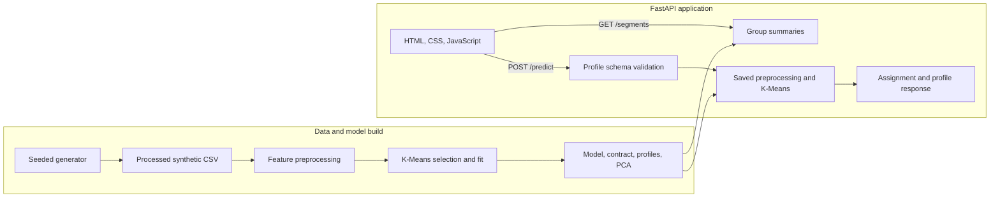

# SegmentIQ architecture

## Current system

SegmentIQ is a small, single-service application. FastAPI serves the browser UI, validates requests, loads the trained scikit-learn pipeline, and returns descriptive results. The frontend is plain HTML, CSS, and JavaScript; it does not have a separate Node build.

## Components

- `ml/src/generate_synthetic_dataset.py` creates a reproducible, 1,600-row synthetic scenario dataset. Its archetype label is not a model feature.
- `ml/src/train.py` scales numeric columns, one-hot encodes categorical columns, compares K=2 through K=8 over five seeds, fits the selected K-Means model, and writes local artifacts.
- `ml/src/predict.py` checks a profile against the generated feature contract and returns its cluster, centroid distance, PCA coordinates, and descriptive profile.
- `backend/main.py` defines the FastAPI routes, validates the 16 profile fields, and serves `frontend/`.
- `frontend/` renders the profile form, segment summaries, and model response in the browser.
- `main.py`, `pyproject.toml`, and `vercel.json` provide the Vercel application entry point and deployment build configuration.

## Generated artifacts

Training writes the fitted preprocessor and model, PCA projection, feature contract, and group profiles to ignored `ml/artifacts/`. The generated dataset and row-level cluster assignments go to ignored `ml/data/processed/`. These files are created locally by the documented setup commands and during the Vercel build; they are not committed to Git.

## Model contract

Training and inference share one preprocessing/model bundle and a generated feature contract. Numeric and categorical field lists live in `ml/src/train.py`; the API request schema in `backend/main.py` validates the same 16 fields. Update both when changing the form or feature schema. The synthetic archetype label is excluded from model features and used only for post-cluster descriptive checks.

PCA is used to provide a two-dimensional projection for exploration. It does not define the clusters. Cluster IDs are arbitrary labels, and the distance to a centroid is a distance in transformed feature space—not a probability or confidence estimate.

## Boundaries and non-goals

- No account, database, or persistence layer exists. Submitted profiles are not stored by the application.
- No external model API or market-data service is used.
- The source CSV reviewed in the research notes is separate from the deployed synthetic pipeline.
- The app is an educational prototype, not an investor suitability, portfolio recommendation, or financial-advice system.
- Future persistence or real-data support requires an explicit privacy, data provenance, license, and access-control design first.
