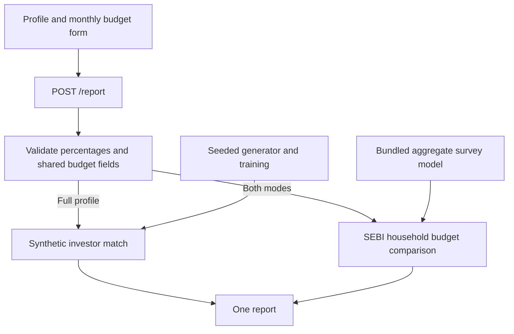

# SegmentIQ architecture

FastAPI serves the browser UI and runs both inference paths in one service. The browser uses HTML, CSS, and JavaScript directly.

## Synthetic investor match

- `ml/src/generate_synthetic_dataset.py` generates 1,600 scenarios and reconciles expenses, repayments, investing, and savings to income.
- `ml/src/train.py` scales numeric features, one-hot encodes categorical features, and compares K-means candidates across five seeds. The current fit uses four clusters. Scenario labels help describe the resulting clusters after fitting.
- `ml/src/predict.py` loads the saved model and returns the closest cluster, descriptive group statistics, centroid distance, and PCA coordinates. Distance measures separation in transformed feature space. PCA provides a two-dimensional projection for exploration.
- Vercel regenerates the model during its build. The generated records and runtime artifacts live under ignored `ml/data/processed/` and `ml/artifacts/`.

## SEBI budget comparison

- The frontend converts the entered monthly amounts to five shares. The investment share combines SIP and other investments.
- `backend/sebi_budget.py` validates and normalizes the shares, applies the square-root transform, and finds the closest saved center.
- `backend/sebi_budget_model.json` stores three centers, reference averages from held-out interviews, model metadata, and the workbook hash. The averages describe eligible households in the investor sample.
- Budget-only requests use `profile: null`. This path compares the budget with the survey reference groups and skips the synthetic profile model.

## Contracts and boundaries

`backend/main.py` defines the request schemas and routes, validates shared values in a combined request, and serves `frontend/`. Keep the browser form, API schema, synthetic feature contract, and example profile aligned when changing inputs.

The application processes submissions in memory. It uses no account system, database, or external model service. Both results are descriptive and intended for exploration.
