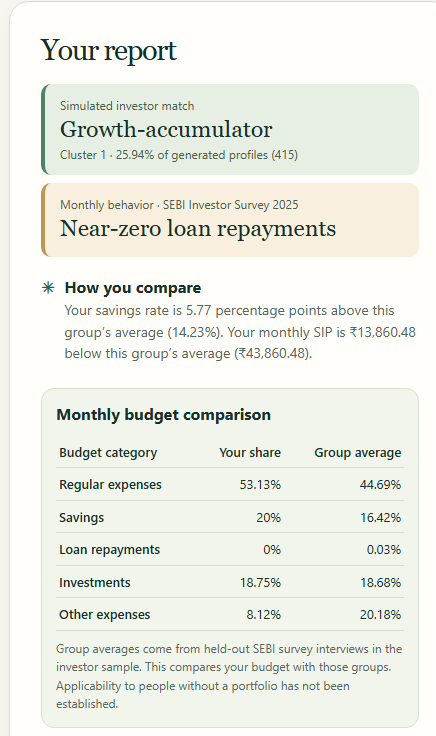
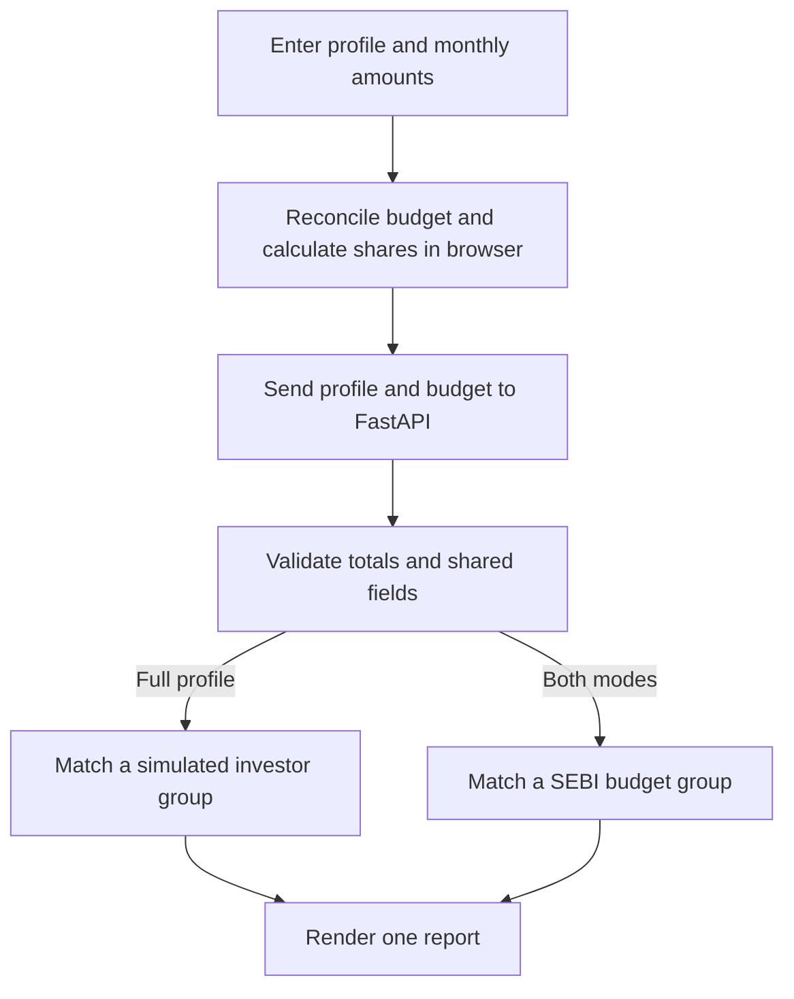

# SegmentIQ project guide

[Live demo](https://segmentiq-khaki.vercel.app/) · [Local setup](../README.md#run-locally) · [Architecture](architecture.md) · [API reference](https://segmentiq-khaki.vercel.app/docs)

## What the app does

SegmentIQ turns one set of browser inputs into two descriptive results. The simulated investor match compares a full profile with generated profiles. The SEBI budget result compares five shares of monthly income with budget patterns in the survey's investor sample.

| Choose | Enter | Receive |
|---|---|---|
| Full report | Profile, monthly budget, investment habits, and portfolio mix | A simulated investor match and a SEBI budget comparison |
| **No current portfolio** | Monthly income and budget amounts | A SEBI budget comparison |

The survey comparison uses the same five amounts in both modes. The optional investor result uses an additional set of profile and investment fields. The live chart shows what you entered before either model runs.

## Complete the form

### Profile and investment inputs

| Section | What to enter |
|---|---|
| About you | Age, city tier, employment, monthly take-home income, regular expenses, savings, main debt type, and total monthly loan repayments |
| Investment habits | Monthly systematic investment plan (SIP) amount, years of investing, self-rated financial literacy from 1 to 10, risk comfort, and primary financial goal |
| Portfolio allocation | Percentage of your current holdings in equity, fixed deposits (FDs), and debt assets. The three percentages must total 100%. |
| Where your monthly money goes | Investments beyond your SIP and other expenses. The form combines these with the amounts entered earlier. |

**Loan repayments** are monthly cash outflows. **Debt assets** are part of the portfolio you hold. The portfolio mix describes holdings, while the budget describes monthly flows.

### Monthly budget categories

| Category | Include |
|---|---|
| Regular expenses | Recurring essentials such as rent, groceries, or utilities |
| Savings | Money set aside for savings, including emergency cash |
| Loan repayments | Total monthly repayments, including applicable loan or credit card payments |
| Investments | SIP contributions plus investments beyond SIP |
| Other expenses | Discretionary spending such as dining out, gifts, or hobbies |

Use the same scope for income and spending. If you enter household income, use household amounts throughout. Count each amount once and enter zero for unused categories. The browser uses paise for reconciliation. The live budget status shows the amount left to allocate or the excess over income.

Use **Use example** to populate both parts of the form. **Undo** restores the previous answers and preserves fields you subsequently edited.

## Read the report

*Report generated using the built-in example. The sample uses ₹1,60,000 in monthly income and allocates ₹85,000 to regular expenses, ₹32,000 to savings, ₹30,000 to investments, and ₹13,000 to other expenses.*

| Report section | What it tells you |
|---|---|
| **Simulated investor match** | The closest group to your full profile in the model's transformed feature space. The cluster number identifies the group. |
| **Monthly behavior** | The nearest of three household budget groups in the bundled SEBI model. |
| **How you compare** | Selected differences between your answers and the simulated group's means. |
| **Monthly budget comparison** | Your five shares alongside the holdout averages of the matched survey group. A share measures a portion of monthly income. |
| **Profile readout** | Cash-flow observations, portfolio mix, and selected preferences. |
| **Investment check-in** | The SIP contribution, the balance after selected costs, and observations about the allocation entered. |
| **Compare values** | Your value appears as a marker, and the simulated group's mean appears as a shaded bar. |
| **Group makeup** | Common answers and numeric averages among the generated profiles assigned to that group. |

Budget-only reports show the monthly behavior card and budget comparison. Changes to the form mark the existing report as stale until you generate it again.

## Model 1 · Simulated investor groups

The seeded generator creates 1,600 profiles around four scenarios: **Capital-preserving**, **Balanced-goal-based**, **Growth-accumulator**, and **Liquidity-first**. Regular expenses, repayments, SIP, other expenses, and savings reconcile to each generated profile's income. Training uses 11 numeric and five categorical features. It standardizes the numeric fields and one-hot encodes categories. The scenario name is held back during training and used afterward to describe each cluster.

The training script evaluates K-means for K=2 through K=8 over five seeds. It chooses the strongest mean silhouette, with seed stability as a tie-breaker. The current run selected K=4 with mean silhouette **0.3061** and mean seed stability **ARI 1.0000**. Silhouette measures separation relative to cohesion in the fitted feature space. Adjusted Rand index measures agreement between cluster partitions after allowing for arbitrary cluster labels.

At inference time the saved preprocessing pipeline transforms one submitted profile, the model chooses the closest center, and the API returns the fitted cluster's descriptive summary. PCA coordinates come from a separate two-dimensional projection. The four groups summarize the generator's scenarios. Their metrics describe synthetic data. [Training workflow](../ml/README.md)

## Model 2 · SEBI household budget groups

The SEBI Investor Survey 2025 asked about allocation of household income among five categories. The bundled SegmentIQ model used **17,824 eligible investor-sample interviews**, with **16,024** for fitting and **1,800** held out to calculate the reference averages shown in the app. SegmentIQ's group names describe the fitted groups and are project labels. [Official SEBI survey report and data](https://www.sebi.gov.in/reports-and-statistics/research/jan-2026/investor-survey-2025-_99170.html)

The model validates and normalizes the five shares, takes the square root of each fraction, and matches the resulting vector to the closest of three K-means centers by squared Euclidean distance. The chart and comparison table round displayed shares separately from the model inputs.

| SegmentIQ group | Holdout interviews | What stands out in the holdout |
|---|---:|---|
| Higher savings and loan repayments | 758 | Savings average 20.10% of income and loan repayments average 16.80%. Both lead the other two groups. |
| Near-zero loan repayments | 574 | Loan repayments average 0.03% of income. |
| Higher monthly expenses | 468 | Regular expenses average 49.81% of income, the highest of the three groups. |

The [aggregate model file](../backend/sebi_budget_model.json) records the workbook hash, seed, fitted centers, group averages, and interview counts. The original workbook stays outside the repository. The held-out averages describe the investor sample. Applicability to people without a portfolio has not been established, so the budget-only path gives them a reference comparison.

## API and application flow

| Request | Use |
|---|---|
| `GET /` | Load the form, chart, and report interface. |
| `GET /health` | Check that the synthetic model artifacts are available. |
| `GET /segments` | Read the simulated group summaries. |
| `POST /report` | Send a profile and budget together. Use `profile: null` for a budget-only response. |
| `POST /predict` | Run just the synthetic investor model. |
| `POST /sebi/predict` | Match just the five budget shares. |
| `GET /docs` | Open the interactive API reference. |

The `budget` object uses percentages in the range 0–100. The application permits up to 0.02 percentage points of rounding difference over the five shares and normalizes them before matching. In a combined request, the backend also checks that regular expenses, savings, and loan repayments agree across the payload and that total investments cover the SIP. A validation failure returns HTTP 422.

The full response has `investor_cluster` and `sebi_budget` objects. In the budget-only response, `investor_cluster` is `null`. The survey object includes the model version and the matched group's ID, name, holdout count, and category averages. The [README API example](../README.md#api) uses the same sample as the browser.

## Run, build, and troubleshoot

- **Local** — Follow the [setup steps](../README.md#run-locally) with Python 3.13. Train the synthetic model before requesting a full report. FastAPI serves the frontend directly.
- **Production** — Vercel builds from GitHub `main`. The build script in [`pyproject.toml`](../pyproject.toml) regenerates the synthetic dataset and artifacts. [`main.py`](../main.py) exposes FastAPI. [`vercel.json`](../vercel.json) configures the runtime.
- **Budget remains unallocated** — Use the on-screen balance to find the difference. Check that **Investments beyond SIP** excludes the SIP entered earlier.
- **Portfolio validation fails** — Adjust equity, FDs, and debt assets to total 100%. Use **No current portfolio** for a budget-only report.
- **Model artifacts unavailable** — Check `/health`, run the generator and trainer, then try again. Inspect the Vercel build for a production failure.
- **Report request fails** — The form lets you retry. It rejects a response if you changed the answers while it was loading.

## Scope and privacy

The app processes submitted values in memory and has no account system or profile database. The repository publishes simulated model code and aggregate survey parameters. Earlier CSV and notebook experiments are documented as [historical research](model_report.md).

The report describes entered behavior and reference groups. Suitability, actual investment performance, and personalized financial decisions require additional evidence. The [scope](requirements.md) and [roadmap](roadmap.md) describe those boundaries and planned validation.
